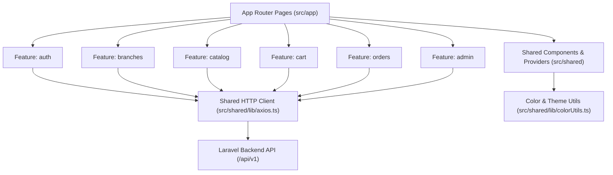

# تقرير الهيكلة المعمارية وشرح ملفات الواجهة الأمامية (Frontend)

**المشروع:** منصة مبيعات وتوريد الجملة B2B — شركة المخازن الاقتصادية  
**المسار:** `c:\xampp\htdocs\store\frontend`  
**التقنيات الأساسية:** Next.js `16.4.6` (App Router) • React `19.3.0` • TypeScript `^5` • Tailwind CSS `4.3.3` • Axios `^1.21.1` • Lucide Icons • `js-cookie`

---

## 1. نظرة عامة على المعمارية (Architecture Overview)

تعتمد الواجهة الأمامية على نمط **المعمارية القائمة على الميزات (Feature-Based Architecture)** إلى جانب **Next.js App Router**، حيث تنقسم الشيفرة المصدرية داخل مجلد `src/` إلى أربع طبقات رئيسية:

1. **طبقة التوجيه والصفحات (`src/app/`):** مسؤولة عن مسارات التطبيق (Routes)، التخطيط العام (Layout)، والأنماط العامة (`globals.css`).
2. **طبقة الميزات (`src/features/`):** تضم وحدات الأعمال المستقلة (`auth`، `branches`، `catalog`، `cart`، `orders`، `admin`)، بحيث تحتوي كل ميزة على:
   - `api/`: دوال الاتصال بنقاط النهاية (Endpoints) عبر `apiClient`.
   - `hooks/`: خطافات React مخصصة لإدارة الحالة والتفاعل مع الـ API.
   - `components/`: مكونات واجهة المستخدم الخاصة بالميزة.
   - `types/`: تعريفات TypeScript الخاصة بالميزة.
   - `index.ts`: ملف Barrel لتصدير واجهة الميزة بشكل موحد.
3. **الطبقة المشتركة (`src/shared/`):** تضم المكونات العامة (`BottomNav`)، مزود الثيم الديناميكي (`ThemeProvider`)، عميل HTTP الموحد (`axios.ts`)، دوال الألوان والتنسيق، والثوابت العامة (`config.ts`).
4. **الأنواع والمكتبات الجذرية (`src/types/` و `src/lib/`):** تحتوي على نماذج البيانات المشتركة (`ApiResponse`, `User`, `Product`, `Cart`, `Order` ...) وملفات مساعدة قديمة/مكررة جزئياً.



---

## 2. الشجرة الكاملة لملفات الواجهة الأمامية

```text
frontend/
├── .dockerignore
├── .env.local
├── .gitignore
├── AGENTS.md
├── Dockerfile
├── README.md
├── eslint.config.mjs
├── next-env.d.ts
├── next.config.ts
├── package-lock.json
├── package.json
├── postcss.config.mjs
├── tsconfig.json
├── tsconfig.tsbuildinfo
├── public/
│   ├── banner-promo.png
│   ├── file.svg
│   ├── globe.svg
│   ├── logo.png
│   ├── next.svg
│   ├── vercel.svg
│   └── window.svg
└── src/
    ├── app/
    │   ├── favicon.ico
    │   ├── globals.css
    │   ├── icon.png
    │   ├── layout.tsx
    │   ├── page.tsx
    │   ├── admin/
    │   │   └── page.tsx
    │   ├── branches/
    │   │   └── page.tsx
    │   ├── catalog/
    │   │   ├── page.tsx
    │   │   └── [id]/
    │   │       └── page.tsx
    │   ├── login/
    │   │   └── page.tsx
    │   └── register/
    │       └── page.tsx
    ├── features/
    │   ├── admin/
    │   │   └── api/
    │   │       └── admin.api.ts
    │   ├── auth/
    │   │   ├── index.ts
    │   │   ├── api/auth.api.ts
    │   │   ├── hooks/useAuth.ts
    │   │   └── types/auth.types.ts
    │   ├── branches/
    │   │   ├── index.ts
    │   │   ├── api/branches.api.ts
    │   │   ├── hooks/useBranches.ts
    │   │   └── types/branches.types.ts
    │   ├── cart/
    │   │   ├── index.ts
    │   │   ├── api/cart.api.ts
    │   │   ├── components/CartModal.tsx
    │   │   ├── hooks/useCart.ts
    │   │   └── types/cart.types.ts
    │   ├── catalog/
    │   │   ├── index.ts
    │   │   ├── api/catalog.api.ts
    │   │   ├── components/
    │   │   │   ├── CatalogHeader.tsx
    │   │   │   ├── CategoryBar.tsx
    │   │   │   ├── ProductCard.tsx
    │   │   │   ├── PromoBannerSlider.tsx
    │   │   │   └── QuantityInput.tsx
    │   │   ├── hooks/useCatalog.ts
    │   │   └── types/catalog.types.ts
    │   └── orders/
    │       ├── index.ts
    │       ├── api/orders.api.ts
    │       ├── hooks/useOrders.ts
    │       └── types/orders.types.ts
    ├── lib/
    │   ├── axios.ts
    │   └── utils.ts
    ├── shared/
    │   ├── components/
    │   │   └── layout/
    │   │       └── BottomNav.tsx
    │   ├── constants/
    │   │   └── config.ts
    │   ├── lib/
    │   │   ├── axios.ts
    │   │   ├── colorUtils.ts
    │   │   └── utils.ts
    │   └── providers/
    │       └── ThemeProvider.tsx
    └── types/
        └── index.ts
```

---

## 3. شرح تفصيلي لجميع الملفات

### أ. ملفات الجذر والإعدادات (Root Configuration & Docker)

| الملف | الوصف والدور |
| :--- | :--- |
| [package.json](file:///c:/xampp/htdocs/store/frontend/package.json) | يعرّف الحزم المعتمدة (`next`, `react`, `axios`, `js-cookie`, `lucide-react`, `clsx`, `tailwind-merge`, `@tailwindcss/postcss`) وأوامر التشغيل والبناء (`dev` و `build` باستخدام `--webpack`، و`start`, `lint`). |
| [package-lock.json](file:///c:/xampp/htdocs/store/frontend/package-lock.json) | ملف قفل الاعتماديات لضمان تثبيت نفس الإصدارات عبر جميع البيئات. |
| [next.config.ts](file:///c:/xampp/htdocs/store/frontend/next.config.ts) | إعدادات Next.js؛ يفعّل قاعدة `turbopack` لمعالجة ملفات `*.css` عبر محمّل `@tailwindcss/turbopack`. |
| [tsconfig.json](file:///c:/xampp/htdocs/store/frontend/tsconfig.json) | إعدادات TypeScript بوضع `strict: true` مع تعريف الاختصار `@/*` ليشير إلى `./src/*`. |
| [tsconfig.tsbuildinfo](file:///c:/xampp/htdocs/store/frontend/tsconfig.tsbuildinfo) | ملف كاش بناء TypeScript التزايدي (توليد تلقائي). |
| [next-env.d.ts](file:///c:/xampp/htdocs/store/frontend/next-env.d.ts) | ملف تعريفات أنواع Next.js المُنشأ تلقائياً لبيئة TypeScript. |
| [eslint.config.mjs](file:///c:/xampp/htdocs/store/frontend/eslint.config.mjs) | إعدادات ESLint v9 بالاعتماد على `eslint-config-next/core-web-vitals` و`typescript` مع استثناء `.next/` و`out/` و`build/`. |
| [postcss.config.mjs](file:///c:/xampp/htdocs/store/frontend/postcss.config.mjs) | يربط PostCSS بإضافة `@tailwindcss/postcss` لتشغيل Tailwind CSS v4. |
| [.env.local](file:///c:/xampp/htdocs/store/frontend/.env.local) | متغيرات البيئة المحلية: `NEXT_PUBLIC_API_URL` (`http://127.0.0.1:8000/api/v1`) و`NEXT_PUBLIC_STORAGE_URL` (`http://127.0.0.1:8000/storage`). |
| [Dockerfile](file:///c:/xampp/htdocs/store/frontend/Dockerfile) | ملف بناء حاوية Docker متعدد المراحل (`deps` ← `builder` ← `runner`) على `node:22-alpine` لتشغيل التطبيق في الإنتاج على المنفذ `3000`. |
| [.dockerignore](file:///c:/xampp/htdocs/store/frontend/.dockerignore) | يستثني مجلدات `node_modules`, `.next`, `out`, `.git`, وملفات `.env` من سياق بناء Docker. |
| [.gitignore](file:///c:/xampp/htdocs/store/frontend/.gitignore) | يحدد الملفات والمجلدات المستبعدة من Git (`node_modules`, `.next`, `.env*`, `*.tsbuildinfo`). |
| [AGENTS.md](file:///c:/xampp/htdocs/store/frontend/AGENTS.md) | ملف إرشادات مُولد تلقائياً بواسطة `next dev` لتنبيه وكلاء البرمجة بخصوص توافق إصدار Next.js. |
| [README.md](file:///c:/xampp/htdocs/store/frontend/README.md) | ملف التوثيق الافتراضي من `create-next-app` الخاص بأوامر التشغيل الأساسية. |

---

### ب. الأصول الثابتة (`public/`)

| الملف | الوصف |
| :--- | :--- |
| [logo.png](file:///c:/xampp/htdocs/store/frontend/public/logo.png) | الشعار الرسمي لشركة المخازن الاقتصادية، يُستخدم في الرأس وبوابة الدخول ولوحة الإدارة. |
| [banner-promo.png](file:///c:/xampp/htdocs/store/frontend/public/banner-promo.png) | الصورة الترويجية الافتراضية التي تظهر في البانر الترحيبي بالصفحة الرئيسية وسلايدر العروض في الكتالوج عند عدم وجود إعلانات مرفوعة من الإدارة. |
| `file.svg`, `globe.svg`, `next.svg`, `vercel.svg`, `window.svg` | أيقونات افتراضية ناتجة عن قالب `create-next-app`. |

---

### ج. طبقة الصفحات والتوجيه (`src/app/`)

تعتمد هذه الطبقة على App Router حيث يمثل كل مجلد مساراً في المتصفح:

| الملف / المسار | الدور والوظيفة |
| :--- | :--- |
| [globals.css](file:///c:/xampp/htdocs/store/frontend/src/app/globals.css) | ملف التنسيقات العام لـ Tailwind CSS v4؛ يحدد خطوط `Cairo` و`Tajawal` و`Plus Jakarta Sans`، ومتغيرات الهوية الملكية الذهبية (`--brand-primary`, `--brand-dark`, `--brand-gradient`...)، وكلاسات مساعدة مثل `.glass-panel`, `.glass-card`, `.btn-shimmer`, `.no-scrollbar`, `.safe-pb`. |
| [layout.tsx](file:///c:/xampp/htdocs/store/frontend/src/app/layout.tsx) | التخطيط الجذري للتطبيق (`RootLayout`)؛ يضبط اللغة العربية واتجاه RTL (`lang="ar" dir="rtl"`)، ويحمّل خطوط Google Fonts، ويحدد `metadata` و`viewport`، ويغلف الصفحات بـ `ThemeProvider`. |
| `favicon.ico` و `icon.png` | أيقونة المتصفح (Favicon) وأيقونة التطبيق داخل App Router. |
| [page.tsx](file:///c:/xampp/htdocs/store/frontend/src/app/page.tsx) (`/`) | **البوابة الموحدة الرئيسية** وتعمل بثلاث حالات:<br>1. **غير مسجل:** نموذج تسجيل الدخول الموحد برقم الجوال وكلمة المرور (تاجر أو مدير)، مع توجيه تلقائي للمدير إلى `/admin` (إلا إذا كان `?view=store`).<br>2. **مسجل وبانتظار الاعتماد (`pending`):** عرض بيانات المنشأة (السجل التجاري، الرقم الضريبي ZATCA) وزر تجربة محاكاة الاعتماد الفوري.<br>3. **تاجر معتمد (`active`) أو معاينة المتجر:** عرض البنر الإعلاني (`home` ads أو الافتراضي)، بطاقة بيانات المنشأة وكود التاجر، وشبكة اختيار المستودعات المعتمدة للدخول إلى `/catalog`. |
| [login/page.tsx](file:///c:/xampp/htdocs/store/frontend/src/app/login/page.tsx) (`/login`) | صفحة إعادة توجيه مباشرة (`redirect('/')`) لأن تسجيل الدخول مدمج في الصفحة الرئيسية. |
| [branches/page.tsx](file:///c:/xampp/htdocs/store/frontend/src/app/branches/page.tsx) (`/branches`) | صفحة إعادة توجيه مباشرة (`redirect('/')`) لأن اختيار المستودعات مدمج في الصفحة الرئيسية بعد الدخول. |
| [register/page.tsx](file:///c:/xampp/htdocs/store/frontend/src/app/register/page.tsx) (`/register`) | صفحة **تسجيل منشأة تجارية جديدة**؛ تتحقق من صحة السجل التجاري (10 أرقام)، والرقم الضريبي ZATCA (15 رقماً يبدأ وينتهي بـ `3`)، وتطابق كلمة المرور، ثم ترسل الطلب عبر `useAuth().register`. |
| [catalog/page.tsx](file:///c:/xampp/htdocs/store/frontend/src/app/catalog/page.tsx) (`/catalog`) | **صفحة كتالوج الجملة للمستودع المختار**؛ محمية للتجار المعتمدين فقط، وتعرض `CatalogHeader` و`CategoryBar` و`PromoBannerSlider` وأقسام المنتجات (الأصناف الجديدة، عروض الجملة المخفضة، وبقية الكتالوج) مع `BottomNav` و`CartModal` وربط الكميات المتفائل بالسلة. |
| [catalog/[id]/page.tsx](file:///c:/xampp/htdocs/store/frontend/src/app/catalog/[id]/page.tsx) (`/catalog/[id]`) | **صفحة تفاصيل الصنف الفردي**؛ محاطة بـ `Suspense` وتجلب بيانات الصنف وأصنافاً مشابهة، وتتيح تكبير الصورة، نسخ الكود والباركود، اختيار الباقة/العبوة، أزرار إضافة كميات الجملة السريعة (`+6, +12, +24, +50`)، وفتح نافذة السلة. |
| [admin/page.tsx](file:///c:/xampp/htdocs/store/frontend/src/app/admin/page.tsx) (`/admin`) | **لوحة التحكم الإدارية المركزية** (مخصصة لدور `admin` فقط، 3244 سطراً)؛ تضم قائمة جانبية للديسكتوب وشريطاً سفلياً للجوال، وبطاقات إحصائيات، وشريط إضافة سريعة، و7 تبويبات رئيسية:<br>- `merchants`: مراجعة واعتماد/إيقاف المنشآت.<br>- `products`: إدارة المنتجات، تعديل سعر الحبة المضمّن، التفعيل/التعطيل، والاستخراج التلقائي من رابط المنتج عبر الذكاء الاصطناعي.<br>- `categories`: إدارة الأقسام الرئيسية والفرعية.<br>- `branches`: إدارة المستودعات وألوان هويتها.<br>- `advertisements`: رفع وتعديل وتفعيل إعلانات الرئيسية والكتالوج.<br>- `orders`: متابعة طلبات الجملة، تغيير حالتها، وفتح الفاتورة PDF.<br>- `users`: عرض الحسابات وإعادة تعيين كلمات المرور. |

---

### د. طبقة الميزات (`src/features/`)

#### 1) ميزة المصادقة (`src/features/auth/`)
| الملف | الوصف |
| :--- | :--- |
| [index.ts](file:///c:/xampp/htdocs/store/frontend/src/features/auth/index.ts) | يعيد تصدير `auth.api` و`useAuth` و`auth.types`. |
| [auth.types.ts](file:///c:/xampp/htdocs/store/frontend/src/features/auth/types/auth.types.ts) | يعرّف واجهات `LoginCredentials` و`RegisterCredentials` و`AuthState`. |
| [auth.api.ts](file:///c:/xampp/htdocs/store/frontend/src/features/auth/api/auth.api.ts) | دوال الاتصال بـ `/auth/login` و`/auth/register` (عبر `FormData`) و`/auth/me` و`/auth/logout` و`/auth/simulate-approval`. |
| [useAuth.ts](file:///c:/xampp/htdocs/store/frontend/src/features/auth/hooks/useAuth.ts) | يدير حالة المستخدم `user` وجلب الجلسة عند التحميل عبر الكوكي `merchant_token`، ويوفر `login` (يحفظ التوكن في `Cookies` و`localStorage` لمدة 30 يوماً)، `register`، `logout`، `refreshUser`، وخاصية `isActiveMerchant`. |

#### 2) ميزة المستودعات والفروع (`src/features/branches/`)
| الملف | الوصف |
| :--- | :--- |
| [index.ts](file:///c:/xampp/htdocs/store/frontend/src/features/branches/index.ts) | يعيد تصدير `branches.api` و`useBranches` و`branches.types`. |
| [branches.types.ts](file:///c:/xampp/htdocs/store/frontend/src/features/branches/types/branches.types.ts) | يعرّف واجهة `BranchState`. |
| [branches.api.ts](file:///c:/xampp/htdocs/store/frontend/src/features/branches/api/branches.api.ts) | دوال جلب قائمة المستودعات `/branches` أو مستودع محدد `/branches/{id}`. |
| [useBranches.ts](file:///c:/xampp/htdocs/store/frontend/src/features/branches/hooks/useBranches.ts) | يجلب المستودعات تلقائياً ويستعيد المستودع المختار من `localStorage` (`selected_branch_id`) ويوفر `selectBranch` و`refreshBranches`. |

#### 3) ميزة الكتالوج والأصناف (`src/features/catalog/`)
| الملف | الوصف |
| :--- | :--- |
| [index.ts](file:///c:/xampp/htdocs/store/frontend/src/features/catalog/index.ts) | يعيد تصدير `catalog.api` و`useCatalog` و`catalog.types`. |
| [catalog.types.ts](file:///c:/xampp/htdocs/store/frontend/src/features/catalog/types/catalog.types.ts) | يعرّف `CatalogFilter` (معاملات التصفية والبحث والترقيم) و`CatalogResponse`. |
| [catalog.api.ts](file:///c:/xampp/htdocs/store/frontend/src/features/catalog/api/catalog.api.ts) | دوال جلب التصنيفات `/categories` والمنتجات `/products` وتفاصيل منتج `/products/{id}`. |
| [useCatalog.ts](file:///c:/xampp/htdocs/store/frontend/src/features/catalog/hooks/useCatalog.ts) | يدير التصنيفات والمنتجات والتصنيف المحدد `selectedCategory` ونص البحث `searchQuery` وحالات التحميل والأخطاء. |
| [CatalogHeader.tsx](file:///c:/xampp/htdocs/store/frontend/src/features/catalog/components/CatalogHeader.tsx) | شريط الرأس الذهبي لصفحة الكتالوج؛ يعرض اسم المستودع، الشعار، زر تبديل المستودع، زر الاتصال السريع (`0553841319`)، وحقل البحث الفوري بالاسم/الكود/الباركود. |
| [CategoryBar.tsx](file:///c:/xampp/htdocs/store/frontend/src/features/catalog/components/CategoryBar.tsx) | شريط تصنيفات ثابت (`sticky`) يدعم الأقسام الرئيسية والفرعية (`children`) بفتح القائمة المنسدلة عند تمرير الماوس على الحاسوب أو النقر على الجوال، مع إغلاق تلقائي عند النقر خارجها. |
| [ProductCard.tsx](file:///c:/xampp/htdocs/store/frontend/src/features/catalog/components/ProductCard.tsx) | بطاقة عرض المنتج في شبكة الكتالوج؛ تعالج رابط الصورة، وتعرض الشارات (`جديد`، `قريباً`، `خصم %`)، مؤشر الكمية بالسلة، الكود، السعر، وأداة `QuantityInput`. |
| [PromoBannerSlider.tsx](file:///c:/xampp/htdocs/store/frontend/src/features/catalog/components/PromoBannerSlider.tsx) | عارض شرائح إعلانية (Carousel) تلقائي كل 5.5 ثوانٍ يتوقف عند التمرير؛ يجلب إعلانات `catalog` من الـ API أو يعرض 3 شرائح ترويجية افتراضية (التوريد المباشر، الخصومات، وصل حديثاً). |
| [QuantityInput.tsx](file:///c:/xampp/htdocs/store/frontend/src/features/catalog/components/QuantityInput.tsx) | مكون التحكم بالكمية (`+` / إدخال رقمي مباشر / `-`) المستخدم في بطاقة المنتج، صفحة التفاصيل، ونافذة السلة. |

#### 4) ميزة سلة الطلبات (`src/features/cart/`)
| الملف | الوصف |
| :--- | :--- |
| [index.ts](file:///c:/xampp/htdocs/store/frontend/src/features/cart/index.ts) | يعيد تصدير `cart.api` و`useCart` و`cart.types`. |
| [cart.types.ts](file:///c:/xampp/htdocs/store/frontend/src/features/cart/types/cart.types.ts) | يعرّف `UpdateCartPayload` و`CartState`. |
| [cart.api.ts](file:///c:/xampp/htdocs/store/frontend/src/features/cart/api/cart.api.ts) | دوال جلب السلة (`GET /cart`)، تحديث عنصر (`POST /cart/items`)، وتفريغ السلة (`DELETE /cart`). |
| [useCart.ts](file:///c:/xampp/htdocs/store/frontend/src/features/cart/hooks/useCart.ts) | يدير حالة السلة بنمط **التحديث المتفائل (Optimistic UI)** مع حساب الإجمالي وضريبة الـ 15% محلياً فوراً (`buildSummary`) وتأجيل المزامنة مع الخادم (`Debounce` بمقدار `350ms`) لتقليل الطلبات أثناء النقر السريع، مع التراجع للحالة الصحيحة عند الفشل. |
| [CartModal.tsx](file:///c:/xampp/htdocs/store/frontend/src/features/cart/components/CartModal.tsx) | نافذة السلة المنبثقة؛ تعرض الأصناف، الكميات، ملخص الضريبة 15%، زر تفريغ السلة، وزر اعتماد ومشاركة الطلب الذي يفتح رابط `whatsapp_share` ويعرض روابط عرض/تنزيل فاتورة PDF عند النجاح. |

#### 5) ميزة الطلبات (`src/features/orders/`)
| الملف | الوصف |
| :--- | :--- |
| [index.ts](file:///c:/xampp/htdocs/store/frontend/src/features/orders/index.ts) | يعيد تصدير `orders.api` و`useOrders` و`orders.types`. |
| [orders.types.ts](file:///c:/xampp/htdocs/store/frontend/src/features/orders/types/orders.types.ts) | يعرّف `CheckoutPayload` و`OrdersListResponse`. |
| [orders.api.ts](file:///c:/xampp/htdocs/store/frontend/src/features/orders/api/orders.api.ts) | دوال جلب الطلبات (`/orders`)، تفاصيل طلب (`/orders/{id}`)، إتمام الطلب (`/orders/checkout`)، وبناء رابط تحميل الفاتورة. |
| [useOrders.ts](file:///c:/xampp/htdocs/store/frontend/src/features/orders/hooks/useOrders.ts) | يوفر `fetchOrders`, `fetchOrderById`, `checkout`, و`getInvoiceUrl` مع إدارة حالات التحميل والإرسال والأخطاء. |

#### 6) ميزة الإدارة (`src/features/admin/`)
| الملف | الوصف |
| :--- | :--- |
| [admin.api.ts](file:///c:/xampp/htdocs/store/frontend/src/features/admin/api/admin.api.ts) | يضم واجهات البيانات (`AdminStats`, `MerchantItem`, `AdminOrder`, `ExtractedProductPayload`, `AdvertisementItem`)، ودالة `getPublicAdvertisements` العامة، وكائن `adminApi` الذي يغطي كافة عمليات الإدارة: الإحصائيات، اعتماد/رفض التجار، الطلبات، المنتجات (بما فيها `extractProductFromUrl` ورفع الصور عبر `FormData`)، الأقسام، المستودعات، المستخدمين (تغيير كلمة المرور)، والإعلانات. |

---

### هـ. الطبقة المشتركة والأنواع والمكتبات (`src/shared/`, `src/types/`, `src/lib/`)

| الملف | الوصف |
| :--- | :--- |
| [src/types/index.ts](file:///c:/xampp/htdocs/store/frontend/src/types/index.ts) | ملف الأنواع المركزي المشترك: `ApiResponse`, `CustomerStatus`, `OrderStatus`, `MerchantProfile`, `User`, `Branch`, `Category`, `ProductPackage`, `Product`, `CartItem`, `CartSummary`, `Cart`, `OrderItem`, `Order`. |
| [src/shared/constants/config.ts](file:///c:/xampp/htdocs/store/frontend/src/shared/constants/config.ts) | الثوابت العامة: `API_BASE_URL`, `STORAGE_BASE_URL`, و`APP_CONFIG` (العملة `ر.س`، نسبة الضريبة `15`، وكود الفرع الافتراضي). |
| [src/shared/lib/axios.ts](file:///c:/xampp/htdocs/store/frontend/src/shared/lib/axios.ts) | نسخة Axios المعتمدة في كل `src/features/*/api`؛ تضبط `baseURL` و`withCredentials: true` وترفق `Authorization: Bearer <token>` تلقائياً من الكوكي أو `localStorage`. |
| [src/shared/lib/colorUtils.ts](file:///c:/xampp/htdocs/store/frontend/src/shared/lib/colorUtils.ts) | دوال تحويل وتفتيح/تغميق الألوان (`hexToRgb`, `adjustBrightness`) ودالة `generateThemeTokens` التي تولد درجات الثيم الذهبي الفاخر وتطبّع ألوان الفروع القديمة. |
| [src/shared/lib/utils.ts](file:///c:/xampp/htdocs/store/frontend/src/shared/lib/utils.ts) | دوال مساعدة لدمج كلاسات Tailwind (`cn`) وتنسيق العملة والأرقام بالعربية السعودية (`formatCurrency`, `formatNumber`). |
| [src/shared/providers/ThemeProvider.tsx](file:///c:/xampp/htdocs/store/frontend/src/shared/providers/ThemeProvider.tsx) | مزود سياق React (`ThemeContext`) يطبق متغيرات CSS (`--brand-primary`, `--brand-dark`, `--brand-light`, `--brand-ring`, `--brand-gradient`) ديناميكياً على عنصر `<html>` عند اختيار مستودع. |
| [src/shared/components/layout/BottomNav.tsx](file:///c:/xampp/htdocs/store/frontend/src/shared/components/layout/BottomNav.tsx) | شريط التنقل السفلي الثابت لصفحات الكتالوج وتفاصيل المنتج؛ يحتوي على 5 أزرار (الرئيسية، الأقسام، الفرز، بحث، السلة مع عداد الأصناف). |
| [src/lib/axios.ts](file:///c:/xampp/htdocs/store/frontend/src/lib/axios.ts) | نسخة بديلة/قديمة من عميل Axios تشير إلى مسار XAMPP المحلي افتراضياً؛ **غير مستخدمة** حالياً لأن طبقة `features` تعتمد على `src/shared/lib/axios.ts`. |
| [src/lib/utils.ts](file:///c:/xampp/htdocs/store/frontend/src/lib/utils.ts) | نسخة مختصرة تحتوي فقط على دالة `cn` (مكررة مع `src/shared/lib/utils.ts`). |

---

## 4. ملاحظات معمارية وفنية مرصودة في الشيفرة

1. **ملفات مكررة غير مستخدمة في `src/lib/`:** يوجد ملفان في `src/lib/axios.ts` و`src/lib/utils.ts` يؤديان نفس غرض `src/shared/lib/axios.ts` و`src/shared/lib/utils.ts`؛ يمكن إزالتهما لاحقاً لتوحيد المرجعية.
2. **روابط الخادم الثابتة في لوحة الإدارة:** في تبويب الطلبات داخل `src/app/admin/page.tsx` (السطران `2331` و`2388`)، رابط فاتورة الـ PDF مكتوب بشكل ثابت `http://127.0.0.1:8000/api/v1/orders/${order.id}/invoice` بدلاً من استخدام `API_BASE_URL` من `src/shared/constants/config.ts`، وهو ما يفضل توحيده قبل النشر على بيئة الإنتاج.
3. **حجم ملف لوحة الإدارة (`src/app/admin/page.tsx`):** يبلغ 3244 سطراً في ملف واحد؛ مستقبلاً يُنصح بتقسيم كل تبويب ونافذة منبثقة إلى مكونات فرعية داخل `src/features/admin/components/` لتحسين قابلية الصيانة.
4. **بعض الأزرار الشكلية أو قيد التطوير:** زر «الفرز» في `BottomNav` داخل `/catalog` يغيّر حالة `activeTab` فقط بدون فتح قائمة فرز، وزر «نبهني عند توفر المخزون» في `ProductCard` و`/catalog/[id]` بدون حدث `onClick` متصل بـ API.
